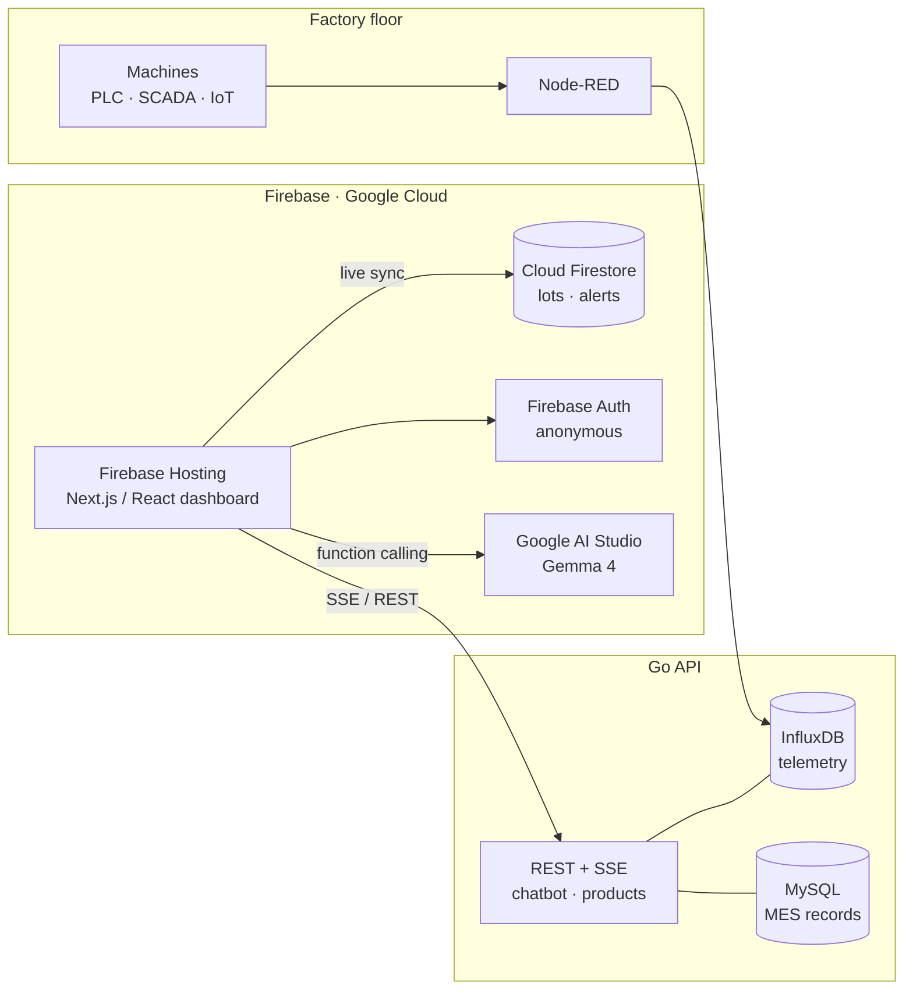

# MINERVA – Industrial Intelligence Platform

A real-time digital twin for sustainable manufacturing. MINERVA shows an
aluminium billet smelter line in 3D, streams live sensor data, predicts
maintenance needs, simulates process changes before they reach the floor,
and answers questions about the plant through an AI assistant built on
Gemma 4.

**Live:** https://minerva-apac.web.app (Firebase Hosting)

---

## Features

| Area | What it does |
| --- | --- |
| **3D digital twin** | The full smelter line in Three.js. Each machine carries a status ring (Running, Idle, Trouble, Maintenance, Shutdown); hovering shows health and alarms. |
| **Live monitoring** | Sensor stream in the top bar, a Live/Demo connection badge, and a plant-level Factory Health (OEE) score. |
| **Machine detail** | Health score, live indicators with units, alarms, predictive maintenance and a prescriptive "what happened / why / what to do" analysis, optionally regenerated by Gemma 4. |
| **Simulation** | Configure product and process parameters, watch the line run, then get a before-vs-after report: yield, defects, energy per billet, CO₂e and cycle time. |
| **Autonomous mode** | Runs the line on current settings and compares the simulated result with real sensor data. |
| **Product data** | Production lots with live sync across viewers: add, acknowledge, validate and delete. |
| **Ask Minerva AI** | Natural-language questions about machines, alarms and production, with three one-tap demo questions. |
| **Responsive** | Desktop rails collapse into a bottom tab bar on phones; machine details open as a bottom sheet. |

## Architecture



| Component | Technology | Status |
| --- | --- | --- |
| Dashboard | Next.js 15 (React 19), static export | ✅ In use |
| Hosting | Firebase Hosting (`minerva-apac`, Spark plan); Cloud Run container also provided | ✅ In use |
| App data (lots, alerts) | Cloud Firestore + anonymous Firebase Auth | ✅ In use, once configured (see [Cloud Firestore](#cloud-firestore)) |
| AI assistant | Google AI Studio, `gemma-4-31b-it` with function calling | ✅ In use |
| Telemetry API | Go service (InfluxDB stream, chatbot, MySQL products) | ✅ In use, hosted separately |
| Managed ML | Vertex AI | 🗓 Planned |

Every feature degrades gracefully. If a service is unreachable, the dashboard
switches to bundled demo data instead of showing an endless spinner (see
[Data sources and demo mode](#data-sources-and-demo-mode)).

## Quick start

Requires Node.js 20+.

```bash
npm ci --legacy-peer-deps
npm run dev
```

Open http://localhost:3000. With no configuration, the app runs entirely on
demo data, so it is useful straight away.

## Configuration

Create `.env.local` in the project root. Every variable is optional.

| Variable | Purpose |
| --- | --- |
| `NEXT_PUBLIC_API_BASE_URL` | Go API base URL. Defaults to `https://minerva-api-go.fly.dev`. |
| `NEXT_PUBLIC_DATA_MODE` | `auto` (default), `mock` or `live`; see below. |
| `NEXT_PUBLIC_GEMINI_API_KEY` | Google AI Studio key for Gemma 4 (Ask AI and prescriptive analysis). |
| `NEXT_PUBLIC_FIREBASE_API_KEY`, `_AUTH_DOMAIN`, `_PROJECT_ID`, `_STORAGE_BUCKET`, `_MESSAGING_SENDER_ID`, `_APP_ID`, `_MEASUREMENT_ID` | Firebase web config. Enables Cloud Firestore. |
| `NEXT_PUBLIC_FIREBASE_EMULATOR` | `1` to use the local Auth and Firestore emulators. |

Values are resolved in two places ([`src/lib/public-env.ts`](src/lib/public-env.ts)):

- **At build time** (local dev, Firebase Hosting): the values in `.env.local`
  are baked in when you run `npm run build`, so build on a machine that has a
  filled-in `.env.local` before deploying.
- **At runtime** (Cloud Run only): the container writes `/env.js` from the
  service's `NEXT_PUBLIC_*` environment variables at startup, which override
  the build-time values without a rebuild.

> **Note:** `NEXT_PUBLIC_GEMINI_API_KEY` is visible in the browser. Restrict
> the key to the site's HTTP referrers in Google AI Studio, and move the calls
> behind a server before production use.

## Data sources and demo mode

| Feature | Primary source | Fallback |
| --- | --- | --- |
| Sensor stream | Go API `GET /api/influx/stream` (SSE) | Generated readings ([`src/lib/sensor-feed.ts`](src/lib/sensor-feed.ts)) |
| Product lots | Cloud Firestore `products` (live), then Go API `/api/products` | Seeded lots in the browser ([`src/lib/products.ts`](src/lib/products.ts)) |
| Notifications | Cloud Firestore `notifications` (live), then Go API `/api/notifications` | [`public/notification-data.json`](public/notification-data.json) |
| Ask AI | Go API `POST /api/chatbot/query`, then Gemma 4 | Offline answers from plant data ([`src/lib/demo-answers.ts`](src/lib/demo-answers.ts)) |
| Simulation report | Computed from the configured parameters | ([`src/lib/simulation-report.ts`](src/lib/simulation-report.ts)) |

The Go API's reachability is checked once through `GET /health`
([`src/lib/backend.ts`](src/lib/backend.ts)). `NEXT_PUBLIC_DATA_MODE` decides
what happens next:

- **`auto`**: use live services when they answer, otherwise demo data. The top
  bar shows **Live** (green) or **Demo** (blue).
- **`mock`**: never call any backend. Use this for demo recordings.
- **`live`**: backend only. Failures show an error with a Retry button after
  10 seconds.

## Cloud Firestore

With the Firebase web config set, each browser signs in anonymously and
reads and writes `products` and `notifications` with live updates. A lot
added in one browser appears in every other open dashboard immediately.
[`firestore.rules`](firestore.rules) allows reads only for signed-in clients,
validates every lot write (id format, allowed fields, types, server
timestamp), and makes alerts read-only for the app.

### One-time setup (project `minerva-apac`)

1. In the Firebase console, open **Databases & Storage → Firestore Database**
   and create the database (Standard edition, location `asia-southeast2`,
   production mode).
2. Open **Security → Authentication**, click **Get started**, and enable
   **Anonymous** under **Sign-in method**.
3. Register a web app and copy its config into `.env.local`:
   ```bash
   npx firebase-tools apps:sdkconfig WEB <APP_ID> --project minerva-apac
   ```
4. Deploy the security rules. The Firebase CLI must be signed in with an
   account that has access to the project (`npx firebase-tools login`):
   ```bash
   npm run deploy:rules
   ```
5. Seed the demo lots and alerts (uses Application Default Credentials):
   ```bash
   gcloud auth application-default login
   npm run seed:firestore -- --reset
   ```
   Re-run the same command to reset the data between demo takes.

### Local emulators

Test without touching the real project:

```bash
# Terminal 1: Auth + Firestore emulators (UI at http://127.0.0.1:4000)
npm run emulators -- --project demo-minerva
```

```bash
# Terminal 2: seed the emulator
FIRESTORE_EMULATOR_HOST=127.0.0.1:8080 FIREBASE_PROJECT_ID=demo-minerva npm run seed:firestore -- --reset
```

```bash
# Terminal 3: run the app against the emulator
NEXT_PUBLIC_FIREBASE_EMULATOR=1 NEXT_PUBLIC_FIREBASE_PROJECT_ID=demo-minerva NEXT_PUBLIC_FIREBASE_API_KEY=demo-key NEXT_PUBLIC_FIREBASE_APP_ID=demo-app npm run dev
```

## Deployment

### Firebase Hosting (current)

The live site is a static export on Firebase Hosting (free on the Spark
plan). Configuration is baked in at build time, so make sure `.env.local` is
filled in (see [Configuration](#configuration)), then:

```bash
npm run deploy:hosting
```

This runs the typecheck and build, then uploads `out/` with
`FIREBASE_HOSTING_UPLOAD_CONCURRENCY=4`. Fewer parallel uploads keep the
larger 3D models (up to 15 MB) from timing out on slower connections. Stop
`npm run dev` before building, since both write to `.next/`.

**Always the latest version, no cache clearing.** HTML, `env.js` and
`version.json` are served `no-cache`/`no-store`, so a normal reload fetches
the newest release. Every build also stamps a unique id
([`scripts/write-version.mjs`](scripts/write-version.mjs)). Open tabs check
`/version.json` every minute and on focus, and show a **"A new version of
MINERVA is available · Reload"** banner when a newer deploy is live
([`src/components/UpdateBanner.tsx`](src/components/UpdateBanner.tsx)).

After the first deploy, add `minerva-apac.web.app` (and
`minerva-apac.firebaseapp.com`) to the Gemini key's allowed HTTP referrers in
Google AI Studio.

### Cloud Run (optional, requires billing)

The [`Dockerfile`](Dockerfile) builds the static export and serves it with
nginx on port 8080. [`docker/write-env.sh`](docker/write-env.sh) writes
`/env.js` from the service's environment at startup, so keys can be set in
the Cloud Run console instead of at build time. Cloud Run needs a billing
account on the project.

1. In Cloud Run, choose **Create service → Continuously deploy from a
   repository**, connect this GitHub repository, branch `^main$`, build type
   **Dockerfile**.
2. Region `asia-southeast2`, allow unauthenticated access.
3. Under **Containers → Variables**, add the `NEXT_PUBLIC_*` values.

Or, with the gcloud CLI:

```bash
gcloud run deploy minerva --source . --region asia-southeast2 --project minerva-apac --allow-unauthenticated
```

## Scripts

| Command | Description |
| --- | --- |
| `npm run dev` | Development server (Turbopack). |
| `npm run check` | Typecheck and production build. |
| `npm run build` | Static export to `out/`. |
| `npm run emulators` | Firebase Auth and Firestore emulators. |
| `npm run seed:firestore` | Seed Firestore with demo lots and alerts (`-- --reset` to clear first). |
| `npm run deploy:rules` | Deploy Firestore rules and indexes. |
| `npm run deploy:hosting` | Build and deploy the site to Firebase Hosting. |

## Project structure

```
Dockerfile                Optional Cloud Run image (static build + nginx)
docker/                   nginx config template, env.js writer
src/
  app/                    Routes: / (dashboard), /compro (redirect), /twin, /geogemma
  components/
    factory-shell/        Dashboard chrome: top bar, rails, mobile tab bar, prompt bar
    simulation/           Simulation provider, scene, configurator and report
    GLTFViewer.tsx        3D twin (Three.js), status rings, hover tooltips
    ModelModal.tsx        Machine detail panel / bottom sheet
    AskAiChat.tsx         Ask AI chat with the fallback chain
    ProductDataViewerModal.tsx
  lib/
    backend.ts            Health check and data-mode selection
    sensor-feed.ts        Shared live/demo sensor feed
    products.ts           Lots: Firestore → Go API → demo store
    firestore.ts          Firestore client with anonymous auth
    public-env.ts         Runtime (env.js) / build-time configuration
    gemini.ts             Gemma 4 client (Google AI Studio)
    machine-display.ts    Status, health tones, indicator labels, OEE
    simulation-report.ts  Before/after process model
  data/demo-lots.json     Demo lots (shared with the seed script)
public/
  3d-model/               GLB models, models.json, machine data
scripts/seed-firestore.mjs
firestore.rules
```

| Route | Purpose |
| --- | --- |
| `/` | Factory dashboard. |
| `/compro` | Company profile. Disabled for the demo build: redirects to `/`. Re-enable by rendering [`src/components/compro/CompanyProfile.tsx`](src/components/compro/CompanyProfile.tsx) from `src/app/compro/page.tsx`. |
| `/twin` | Previous dashboard layout, kept as a fallback. |
| `/geogemma` | Earth-observation demo (mock data). |

## Demo checklist

Before recording, confirm on https://minerva-apac.web.app:

- [ ] The top bar shows sensor values within 5 seconds.
- [ ] Product Data lists at least 3 lots.
- [ ] Ask AI answers a suggested question in under 10 seconds.
- [ ] Furnace (2) detail shows values that change over time.
- [ ] A simulation runs to the report (or use **Skip to report**).
- [ ] Layout works at 1920×1080 and at 375 px wide.

## Known limitations

- The Go API runs outside this repository. When it is down, the app falls back
  to demo data. Restoring live telemetry needs the API up, CORS allowed for
  `https://minerva-apac.web.app` (including SSE), and a `GET /health` endpoint.
- Gemma 4 is called directly from the browser (see the note under
  [Configuration](#configuration)).
- Read/unread state for notifications is kept per browser.
